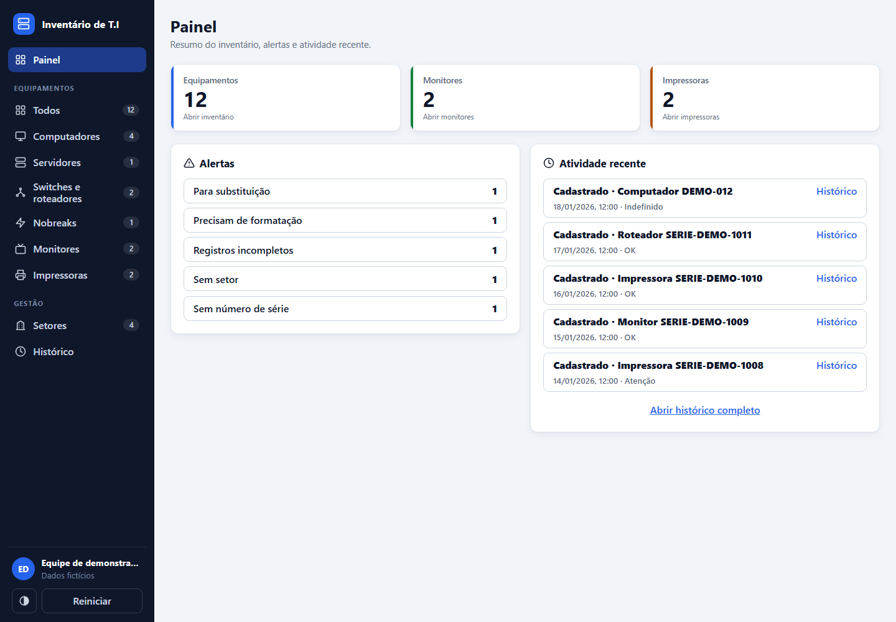
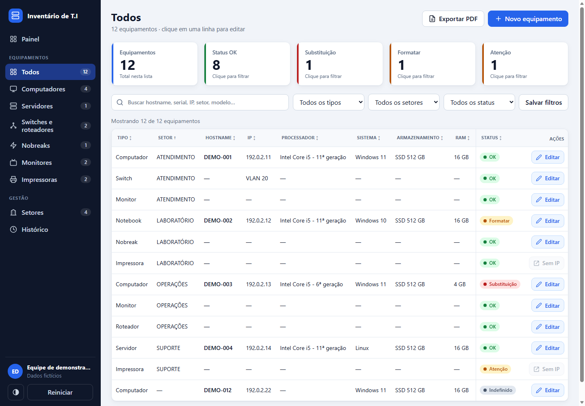
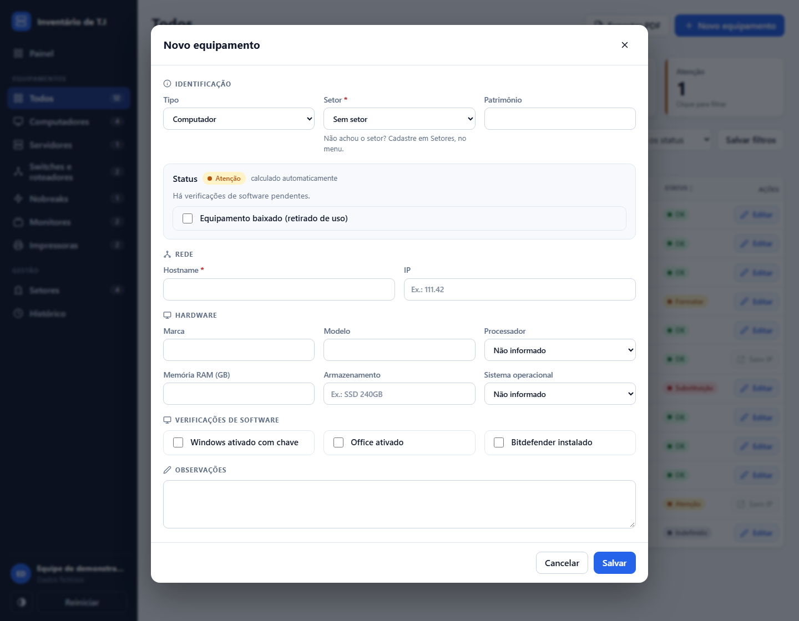
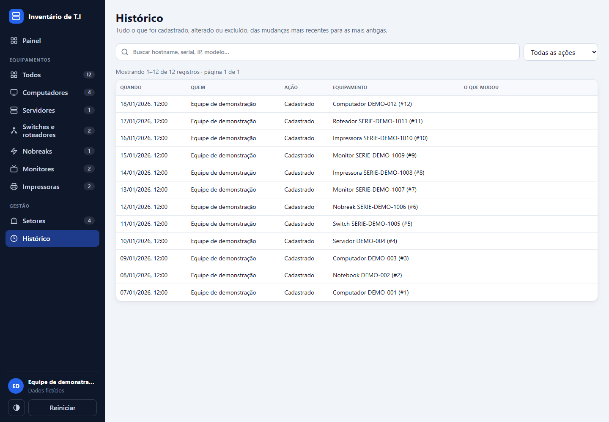
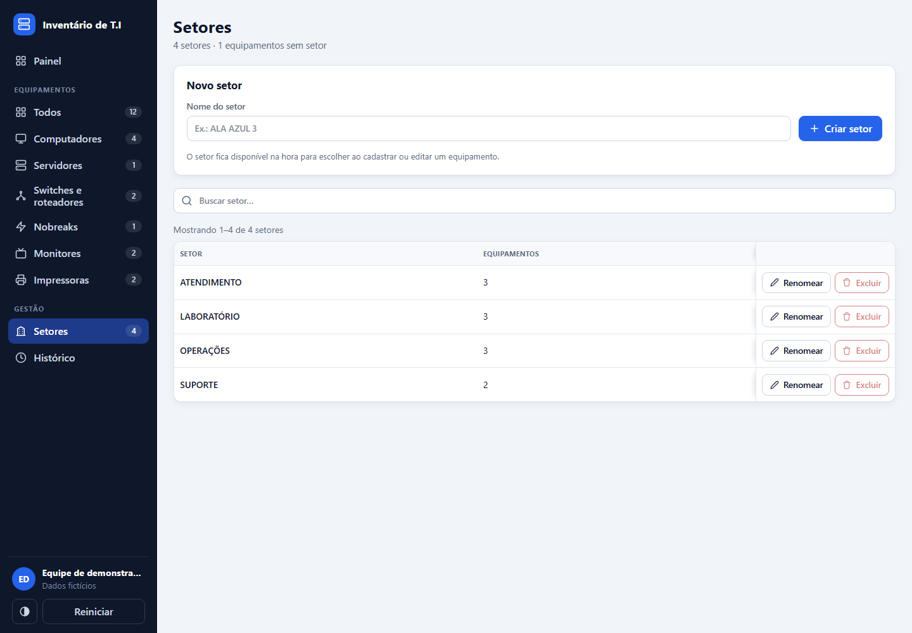

# Inventário de TI

Demonstração de um sistema de gestão de equipamentos de TI. Explore o painel, cadastre um equipamento e acompanhe a mudança no histórico. A aplicação abre com **12 equipamentos e 4 setores fictícios**.



## Desenvolvimento

Esta demonstração foi desenvolvida com inteligência artificial (IA), usando o OpenAI Codex.

## O que você pode fazer

| Tela | Recursos |
| --- | --- |
| Painel | Consultar totais, alertas e atividades recentes |
| Inventário | Buscar e filtrar equipamentos por categoria, setor e situação |
| Cadastro | Criar, editar e excluir registros com campos específicos por tipo de equipamento |
| Setores | Organizar os equipamentos e gerenciar os setores |
| Histórico | Consultar inclusões, alterações e exclusões |
| Relatórios | Gerar PDFs a partir da seleção no inventário |

## Rodar localmente

Você precisa do Node.js 24 ou superior e do npm. Na pasta do projeto, execute:

```bash
npm ci
npm run dev
```

Abra o endereço mostrado no terminal. Na tela de login demonstrativa, preencha os dois campos com qualquer valor fictício (por exemplo, visitante e demo123). Os valores são descartados ao entrar. Cada navegador guarda suas alterações no armazenamento local. Use **Reiniciar** no menu para voltar aos dados iniciais.

## Roteiro de apresentação

1. Abra **Todos** para ver equipamentos de várias categorias e experimentar os filtros.
2. Clique em **Novo equipamento**, escolha um setor e preencha o cadastro.
3. Abra **Histórico** para conferir a inclusão ou volte ao inventário para gerar um PDF.

## Galeria

| Inventário | Cadastro |
| --- | --- |
|  |  |

| Histórico | Setores |
| --- | --- |
|  |  |

## Tecnologias e estrutura

- **React e TypeScript** para a interface e as regras do inventário.
- **Vite** para desenvolvimento e compilação.
- **jsPDF e jsPDF-AutoTable** para os relatórios em PDF.
- [src/demonstracao.ts](src/demonstracao.ts) contém os exemplos e a persistência local.
- [docs/prints](docs/prints) reúne as capturas da versão de demonstração.

A demonstração usa dados fictícios e opera no navegador. O login simula a entrada no sistema. Gestão de usuários e backup de produção ficam fora deste repositório.

Para verificar o código e testar a compilação localmente:

```bash
npm run lint
npm run build
npm run preview
```
